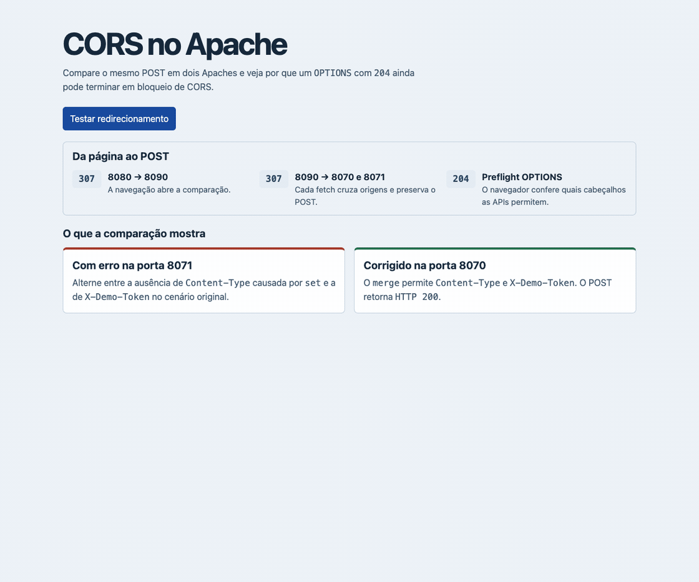
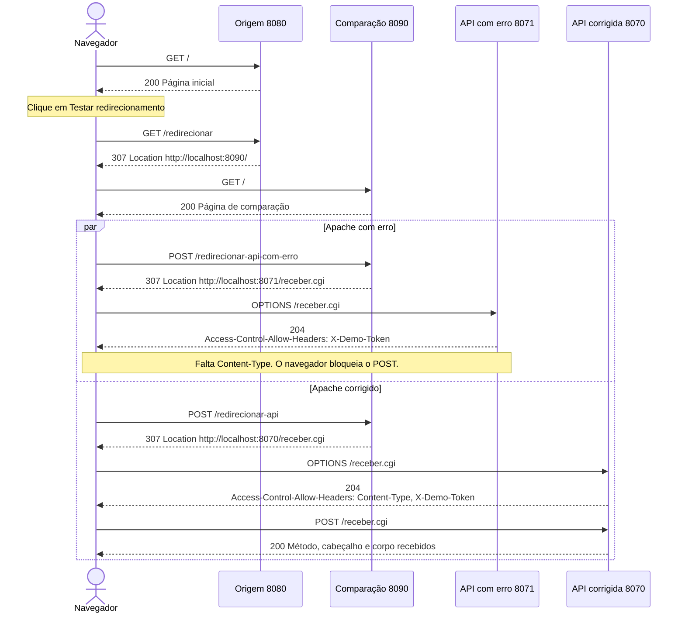

# CORS no Apache com HTTP 307

Esta prova de conceito envia o mesmo POST para duas APIs Apache. As duas respondem `204` ao preflight, mas o navegador só envia o POST à API que permite todos os cabeçalhos solicitados.



## Executar localmente

Você precisa do Docker em execução e do Docker Compose v2.

1. Clone o repositório e entre na pasta onde está o [compose.yaml](compose.yaml).

   ```sh
   git clone https://github.com/guichafy/demo-cors-redirect.git
   cd demo-cors-redirect
   ```

2. Suba os quatro Apaches e confira o estado dos serviços.

   ```sh
   docker compose up -d
   docker compose ps
   ```

3. Abra [http://localhost:8080](http://localhost:8080) e clique em **Testar redirecionamento**. O navegador segue o primeiro `307` para a [página de comparação](http://localhost:8090), que executa o teste automaticamente.
4. Na comparação, mantenha **JSON com X-Demo-Token** para reproduzir os dois bloqueios da `8071`. A `8070` retorna `HTTP 200` nos dois cenários.

| Porta | Serviço | Papel na demonstração |
| --- | --- | --- |
| `8080` | `origem` | Página inicial e redirecionamento da navegação |
| `8090` | `destino` | Comparação e rotas de redirecionamento do `fetch` |
| `8071` | `api-com-erro` | Preflight com um cabeçalho a menos |
| `8070` | `api` | Preflight com a lista completa |

A entrada na `8080` usa o loopback IPv6 (`::1`). Se a porta estiver ocupada ou o IPv6 estiver indisponível, suba com `IP_ORIGEM=127.0.0.1 PORTA_ORIGEM=8081 docker compose up -d` e abra [http://localhost:8081](http://localhost:8081).

## Fluxo via HTTP 307

O diagrama mostra o teste inicial com **Falta Content-Type** e **JSON com X-Demo-Token**. Na página da `8090`, os dois `fetch` partem em paralelo. O preflight de cada API leva `Origin: http://localhost:8090` e `Access-Control-Request-Headers: content-type,x-demo-token`.



## Roteiro da demonstração

1. Em **Via HTTP 307**, compare os cartões. Os dois preflights retornam `204`. A `8071` permite só `X-Demo-Token`, então o navegador bloqueia o POST com JSON porque falta `Content-Type`.
2. Em **Erro na porta 8071**, escolha **Falta X-Demo-Token (original)**. A API passa a permitir só `Content-Type` e a mensagem aponta `x-demo-token`. Com o `307`, ela inclui `(redirected from 'http://localhost:8090/redirecionar-api-erro-original')`.
3. Troque **Caminho do POST** para **Direto para a API**. O mesmo preflight bloqueia o POST e a linha do tempo começa no `OPTIONS`.
4. Para testar um único cabeçalho no preflight, selecione **Texto simples com X-Demo-Token** ou **JSON sem X-Demo-Token**. O primeiro pede permissão só para `x-demo-token`. O segundo pede só `content-type`.

Os códigos `307` e `204` na interface refletem a configuração da PoC. O resultado do POST vem do `fetch`. A página reconstrói a mensagem de CORS do Chrome com a rota e o cabeçalho ausente do cenário.

## Configuração do Apache

Os dois servidores carregam [apache/api-base.conf](apache/api-base.conf), que permite `Content-Type`, e usam o mesmo [endpoint CGI](api/receber.cgi).

- Na `8071`, [api-com-erro.conf](apache/api-com-erro.conf) usa um segundo `set` para substituir a lista por `X-Demo-Token`. O cenário original usa `/receber.cgi?cenario=original` e mantém só `Content-Type`.
- Na `8070`, [api.conf](apache/api.conf) usa `merge` para adicionar `X-Demo-Token` à lista existente.

Uma única diretiva `set` também funciona com a lista completa.

```apache
Header always set Access-Control-Allow-Headers "Content-Type, X-Demo-Token"
```

Se editar uma configuração do Apache, reinicie o serviço correspondente para recarregá-la. Por exemplo, `docker compose restart api-com-erro` recarrega a configuração da `8071`.

## Encerrar

```sh
docker compose down
```
